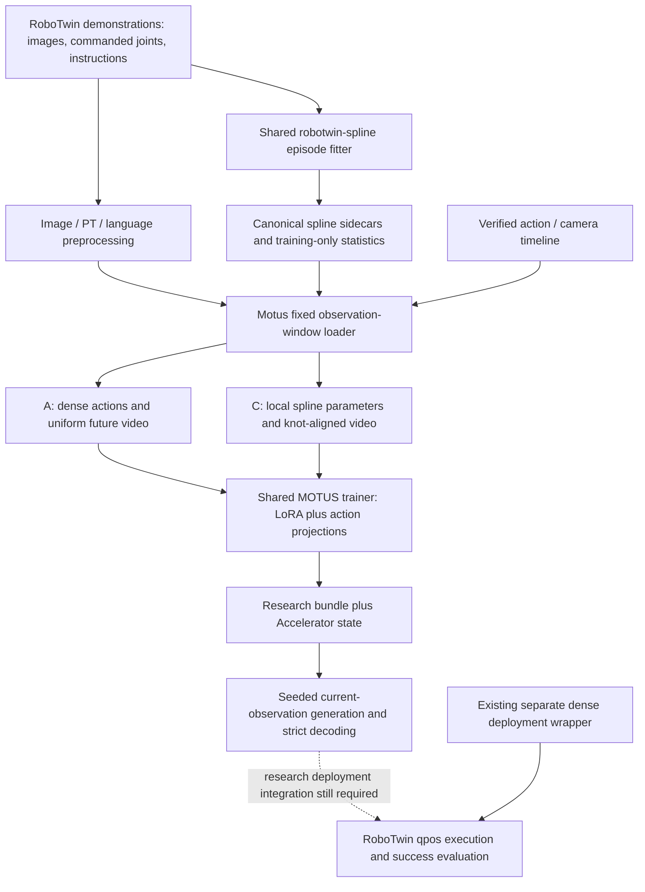

# Adaptive spline MOTUS on RoboTwin: implementation and A/C research protocol

> Historical research notes. Earlier commands, gates, and parameter counts
> describe previous stages. Use the [experiment README](../README.md)
> for the maintained preparation and training workflow.


Inspection date: **2026-11-15**. This document describes the two local working
trees, including existing uncommitted work. It is a source-based research
description and reproduction guide. No training, allocation, simulator rollout,
or experiment-behavior change was performed to write it.

## 1. Research contribution and present status

Our extension replaces the action sequence predicted by MOTUS with local
parameters of an adaptively fitted, whole-demonstration cubic B-spline. It also
aligns future-video supervision with spline knots. The dense comparison uses
the same observation windows and adapter-training procedure. The research
question is whether this combined change can preserve manipulation success and
improve **measured** efficiency under matched training and execution conditions.

The mathematical preprocessing, local target representation, model changes,
adapter training, strict decoding, and diagnostic evaluation have implementations.
The current research trainer is deliberately restricted to a tiny diagnostic.
**There is no completed, reproducible current A/C training-and-RoboTwin-success
comparison.** Full pilot training and research-checkpoint deployment remain
blocked by data, asset, integration, and experiment-definition gaps described
below. Spline representation alone establishes no speedup.

The letters are established by
[the workspace research plan](../../../../motus_robotwin_research_plan.md),
[RESEARCH_TRAINING.md](RESEARCH_TRAINING.md), and, operationally,
[A's configuration](../configs/robotwin_research_A.yaml) and
[C's configuration](../configs/robotwin_research_C.yaml):

| Variant | Meaning in this implementation | Role |
| --- | --- | --- |
| Original checkpoint | Existing dense MOTUS, without our matched adapter training | Separate deployment baseline; not A |
| A | Dense absolute joint/gripper targets, original uniform video target grid, matched LoRA and reset action projections | Matched training baseline |
| C | Native prediction of packed cubic spline parameters, knot-aligned video targets, matched LoRA and reset action projections | Combined proposed method |

A/C jointly change action representation, video timing, and C's padding masks.
They do not isolate the contribution of knot-aligned video. No experiment B or
additional ablation is inferred here. This is our adaptation to MOTUS/RoboTwin;
source inspection does not establish an exact reproduction of an external paper.

### 1.1 Inspected revisions and ownership of changes

The workspace root is not a Git repository. Both children are on `b-spline`:

| Repository | Inspected HEAD | Relevant additions in history |
| --- | --- | --- |
| Motus | `649063e76e41600856dcfd79dc5960230b631584` | `b41664f`: adaptive conversion/local extraction/replay; `69d0fd6`: matched LoRA, loader/model/trainer/mask/diagnostic changes; `8790387`: pilot preparation and dense deployment fixes; `649063e`: delegate shared spline math to WAM-RoboTwin |
| WAM-RoboTwin | `58e399bf95cc1ab6423f26d7dd727d45030be170` | Standalone `robotwin-spline` package, canonical sidecars, plotting, and saved-expert-path replay |

The older MOTUS backbone, trimodal architecture, ordinary dense dataset path,
and device support predate these spline changes. The new package consolidates
previous Motus conversion/replay implementations; the removed Motus
`convert_episode_spline.py` and `replay_episode_spline.py` are not current CLIs.

The inspected working tree also contains existing corrections beyond HEAD:

- Motus: cache-schema/identity, timestamp, and split-alias validation in
  `research_windows.py`; optional WandB import and failure on missing resume
  checkpoints in `train.py`; initialization of the scheduler's first LR;
  associated tests; the untracked cluster wrappers/resolver, real-window audit,
  and `experiments/ac_spline_pilot/docs/CLUSTER_AC_AUDIT.md`.
- WAM-RoboTwin: support for v1.0 `/action/joint_states` in the shared reader,
  `.gitignore` changes, and an already-staged `robotwin.sh` container launcher.

These are pre-existing changes, not changes made by this documentation task.
Checking out the HEADs alone will omit them. A reproducible release must preserve
the reviewed diffs, cluster scripts, dependencies, and XPolicyLab submodule
revision along with both repository revisions. Capture `git diff`,
`git diff --cached`, and untracked source files separately; a commit ID does not
identify a dirty working tree.

## 2. Components and data flow



The diagram shows implemented modules and the incomplete deployment connection;
it does not assert that the whole chain has run on the installed data.

| Responsibility | Implementation reference | Current support |
| --- | --- | --- |
| Record/convert ordinary demonstrations | WAM [pkl2hdf5.py](../../../../WAM-RoboTwin/envs/utils/pkl2hdf5.py), [process_data_xpolicylab.py](../../../../WAM-RoboTwin/scripts/process_data_xpolicylab.py) | Current XPolicyLab HDF5 state/action layout |
| Original MOTUS image/PT/T5 conversion | [robotwin_converter.py](../../../data/robotwin2/robotwin_data_convert/robotwin_converter.py) | Legacy raw layout; incomplete for installed v1.0 data |
| Normalize and fit episode curves | WAM [core.py](../../../../WAM-RoboTwin/scripts/spline_tools/robotwin_spline/core.py), [convert.py](../../../../WAM-RoboTwin/scripts/spline_tools/robotwin_spline/convert.py), [sidecar.py](../../../../WAM-RoboTwin/scripts/spline_tools/robotwin_spline/sidecar.py) | Numerical conversion without model or simulator imports |
| Canonical local support and evaluation | WAM [local.py](../../../../WAM-RoboTwin/scripts/spline_tools/robotwin_spline/local.py) | Unpadded support extraction and strict evaluation |
| Model-specific packing, time statistics, video selection | [adaptive_spline.py](../../../data/robotwin2/adaptive_spline.py) | 36-row targets and 16-command decoding grid |
| Manifest validation and sampling | [research_windows.py](../../../data/robotwin2/research_windows.py), [robotwin_agilex_dataset.py](../../../data/robotwin2/robotwin_agilex_dataset.py), [data/dataset.py](../../../data/dataset.py) | Fixed, source-bound PT windows; shared frame/language processing |
| Training and native generation | [models/motus.py](../../../models/motus.py), [action_expert.py](../../../models/action_expert.py), [train.py](../../../train/train.py) | Dense or spline flow targets; experiment gates permit tiny diagnostics |
| Adapters, contracts, bundles | [research.py](../research.py) | Matched trainable scope, strict compatible-base loading, portable metadata |
| Diagnostic scoring | [diagnostic.py](../diagnostic.py), [sample.py](../../../train/sample.py) | Multi-noise generation, decoded error, validity, plots, fresh-process comparison |
| Ground-truth replay | WAM [replay.py](../../../../WAM-RoboTwin/scripts/spline_tools/robotwin_spline/replay.py) | Saved-seed/path expert replay; missing local recording metadata blocks use |
| Existing dense policy/controller | [deploy_policy.py](../../../inference/robotwin/Motus/deploy_policy.py), WAM [_base_task.py](../../../../WAM-RoboTwin/envs/_base_task.py) | Dense full-checkpoint wrapper; current A/C bundle integration is absent |

### 2.1 Recorded actions, state, and images

The audited embodiment is `aloha_agilex`, with a 14-dimensional command vector:

\[
a_i=(q^L_{i,1:6},g^L_i,q^R_{i,1:6},g^R_i).
\]

Arm commands are absolute joint positions in radians; columns 6 and 13
(zero-based) are continuous gripper open fractions. The spline does not predict
joint velocities, deltas, or end-effector positions. WAM's
`robot.py:get_left_arm_jointState/get_right_arm_jointState` read arm **drive
targets**. Separate `*_real_jointState` methods read simulated joint positions.
The word “state” in these data therefore must not automatically be interpreted
as measured proprioception.

Two recording formats coexist:

| Format | Commands | Current conditioning / images |
| --- | --- | --- |
| Legacy raw MOTUS source | `/joint_action/vector` | `/observation/{head,left,right}_camera/rgb`; legacy loader uses command row at observation as its state |
| Installed XPolicyLab HDF5 `v1.0` | `/action/joint_states`, verified against left-arm, left-gripper, right-arm, right-gripper component arrays | Separate `/state/joint_states`; `/vision/.../colors` images |

In `pkl2hdf5.py:create_xpolicylab_hdf5`, state is recorded rows `[:-1]`, action
is recorded rows `[1:]`, and images are rows `[:-1]`. Thus action row `i` is
already the next recorded command associated with observation/state row `i`.
Do not shift actions again when reading this format. The new shared reader
accepts its action arrays for numerical fitting, but does not adapt the image
and state pipeline.

**Important unresolved mismatch:** `research_windows.py:window_targets` currently
returns `initial_state=actions[observation_index]`, and `_research_sample` checks
the entire PT command stream against cached actions. That matches the legacy
MOTUS command-stream convention, but copying the installed `/action` array to
PT would condition on an already-next command instead of `/state`. The original
converter also expects the legacy camera paths and action key. A complete
v1.0-to-MOTUS adaptation, with explicit temporal and state semantics, is missing.
The existing raw-HDF5 numerical audit does not close this gap.

For the legacy path, the converter places the head view above two half-size
wrist views (left then right), writes `videos/<id>.mp4`, `qpos/<id>.pt`, and
`metas/<id>.txt`, and optionally creates `umt5_wan/<id>.pt`. It prefixes
instructions with the three-view industrial-scene description. T5 and VLM use
the same selected instruction index. The research loader fixes `language_index`
(default 0), loads the current image and eight future target images, and resizes
to **384 high × 320 wide**, with floating RGB in `[0,1]`.

The converter configuration defaults to MP4 height 360 and FPS 30, whereas the
model configuration uses height 384. Runtime image resizing exists, but actual
camera/compression/interpolation parity remains unverified. MP4 playback FPS,
comments giving example frame rates, and HDF5 `frequency` metadata do not by
themselves establish the controller clock. The HDF5 writer receives
`int(save_freq or 15)` as frequency, so its physical interpretation requires
checking the collection schedule.

## 3. Mathematical representation and preprocessing

### 3.1 Training-only action normalization

Split episodes before inspecting their action values. For each channel, let
\(l_j,h_j\) be the minimum and maximum over training episodes only. For a
nonconstant channel:

\[
y_{ij}=2\frac{a_{ij}-l_j}{h_j-l_j}-1,
\qquad
a_{ij}=l_j+\frac{y_{ij}+1}{2}(h_j-l_j).
\]

`core.py:normalize/decode` implement this affine map without clipping validation
outliers. A training-constant channel maps to zero and decodes to its training
constant; a source episode that differs on such a channel is rejected.
Normalization is shared across episodes and splits, not recomputed per episode.

`convert.py` sorts eligible input files, uses
`np.random.default_rng(seed).permutation`, reserves
`ceil(N * validation_fraction)` validation episodes (at least one, at most
`N-1`), and streams bounds from training episodes. Defaults are seed 0 and
validation fraction 0.1: **50 episodes imply 45/5**, while 500 imply 450/50.
A single-episode provisional fit requires `--diagnostic-only`; its statistics
are rejected by research training.

### 3.2 Whole-episode adaptive cubic fitting

The spline coordinate is the original **source action-row index**
\(u_i=i\), not seconds. Given normalized \(Y\in\mathbb R^{T\times14}\), fit

\[
\widehat y(u)=\sum_{r=0}^{K-1}N_{r,3}(u;U)c_r,
\qquad |U|=K+4.
\]

All channels share the same nondecreasing knot vector \(U\); coefficients
\(c_r\in\mathbb R^{14}\) differ across channels. The basis is the usual cubic
B-spline basis. In particular, starting with interval indicator functions
\(N_{r,0}(u)\), its recursion is

\[
N_{r,p}(u)=
\frac{u-U_r}{U_{r+p}-U_r}N_{r,p-1}(u)+
\frac{U_{r+p+1}-u}{U_{r+p+1}-U_{r+1}}N_{r+1,p-1}(u),
\]

with zero-denominator terms taken as zero and the endpoint convention supplied
by SciPy. Control points are coefficients, not sampled actions or points the
curve must pass through.

For each candidate knot vector, form \(B_{ir}=N_{r,3}(i;U)\) and solve

\[
C^*=\operatorname*{argmin}_C\|BC-Y\|_F^2.
\]

`core.py:fit_episode` uses SciPy `generate_knots(k=3,s=1e-12)` for the
FITPACK-style sequence of candidate knots and
`make_lsq_spline(...,method="qr")` for each coefficient solve. It checks
ordered positive basis supports for independent constraints. The initial
clamped cubic has four repeated endpoints at 0 and \(T-1\); endpoint **values**
are not constrained to match recorded actions. Do not substitute a hand-written
“insert at the largest residual” rule: that describes an intuition, not this
implementation's exact insertion policy.

The acceptance statistic is maximum elementwise sampled residual:

\[
E_{\max}=\max_{i,j}|\widehat y_j(i)-y_{ij}|\leq\varepsilon,
\qquad \varepsilon=0.01\text{ by default}.
\]

The generator smoothing value `s=1e-12` is not this tolerance. Fitting stops
successfully only when the sampled maximum criterion passes; exhaustion,
inadmissibility, or a control-point cap produces a failed-fit report. The
default cap is at most \(T\). In physical action units, tolerance 0.01 implies
sampled error at most \(0.005(h_j-l_j)\) for a nonconstant channel, not
0.01 radians universally.

This criterion does not bound between-sample motion, robot tracking, or success.
`range_diagnostics` evaluates cubic extrema through derivative roots to report
overshoot relative to demonstrated channel ranges. Coefficients and decoded
grippers may leave the demonstrated range even when sampled error passes.

### 3.3 Sidecars and provenance

The shared format is `robotwin-episode-cubic-v1`. A compressed `.npz` contains
`knots`, `control_points`, `degree`, `actions`, `source_indices`, and JSON
`metadata`. It stores the **canonical episode curve**, not packed model targets
or copied images. Metadata includes:

- Source resolved path, size, mtime, and SHA-256 of loaded action bytes.
- Training-only bounds, split membership, and normalization identity.
- Solver/version/settings/history, residuals, range diagnostics, and success.
- Source-row time units, optional explicitly verified seconds mapping, image
  references, package converter version, and metadata identity.

The writer uses exclusive creation. `read_cache` disables NumPy pickle loading
but is not a complete source-verification operation. The research consumer
additionally checks schema, metadata identity, action hash, normalization,
sampled reconstruction, split membership, and timeline. Source identities and
splits are path-sensitive: moving raw data to PT or changing absolute paths is
not a transparent cache migration.

The old caches in `outputs/place_can_basket-500` and `.runtime/datasets` use
`cubic-absolute-containing-v1`. That is not the current sidecar schema. Reuse
requires explicit validation/regeneration; renaming the schema is insufficient.

### 3.4 Local prediction target: 36 × 15

WAM `extract_segment` selects the containing knot span \(s\), starts at
\(s-3\), and slices contiguous support without refitting. Motus
`extract_local` requests 36 knots. With full support this yields 32 effective
coefficient rows because a canonical cubic requires four more knots than
coefficients. The valid interval is
\([U^{loc}_3,U^{loc}_{n-4}]\), where \(n\leq36\) is the real local knot count.

At observation row \(o\), pack row \(r\) as

\[
P_r=\left[
\frac{U^{loc}_r-o-b}{s_t},\ c^{loc}_{r,1},\ldots,c^{loc}_{r,14}
\right]\in\mathbb R^{15},\qquad P\in\mathbb R^{36\times15}.
\]

The first coordinate is an **observation-relative absolute knot position**,
affinely scaled by offset \(b\) and positive scale \(s_t\); it is not a knot
increment. Negative support positions are retained. Parameters serialize as
FP32. The coefficient coordinates are in normalized action space.

To give every row 15 coordinates, the extractor also packs four structural
coefficient rows beyond the 32 effective rows. These can be subsequent global
coefficients; they are not necessarily zeros or repeats. Near the episode end,
missing knots and coefficients repeat their last values. All 36 parameter rows,
including structural and deterministic padding entries, receive action loss.
The decoder uses only coefficients active for the canonical local curve.

`fit_knot_time_scaling` must receive exactly the complete successful **training**
cache set from one normalization/split, checking source path/hash membership.
It scans all integer observation rows, gathers relative knot extrema
\(u_{min},u_{max}\), and sets

\[
b=(u_{min}+u_{max})/2,
\qquad s_t=\max((u_{max}-u_{min})/2,1).
\]

Persist that returned object and use it unchanged for A, C, validation, and
inference. Identity scaling marked `diagnostic-only` is accepted for numerical
inspection, not training. The raw-HDF5 one-window audit uses diagnostic scaling.

## 4. Window semantics and future-video supervision

### 4.1 Dense commands and common conditioning

The executable research configuration fixes eight future video frames,
video/action ratio 2, and source stride 3. At observation row \(o\), both
variants are scored/decoded on

\[
i_k=\min(o+3k,T-1),\qquad k=1,\ldots,16.
\]

A's training target is the **raw**, unnormalized \(16\times14\) command array
at those rows. Its eight video targets correspond to \(i_2,i_4,\ldots,i_{16}\),
i.e. offsets 6,12,…,48 before tail clamping. The verified action-to-camera
timeline maps those rows to nearest camera timestamps. A retains original
repeated-tail supervision and latent-valid mask `[true,true,true]`.

C predicts \(P\) directly. It does not predict dense actions followed by a
post-hoc spline fit. Its input/output widths, noisy training sequence,
positional sequence, velocity target, and generated sequence are all 36 × 15.
The local/global equivalence check decodes the packed ground-truth packet on
the same 16-command grid, requiring absolute agreement within `2e-5` against
the global curve. Short support rejects a window, including for the common
manifest used by A. Full-episode coverage of all candidate windows has not
been demonstrated.

Current conditioning is shared: current composed RGB image, raw 14D
command-state convention, cached T5 context, and VLM inputs from the same
current image/instruction. The raw state is not the spline parameter vector
and does not receive action min/max normalization. “Raw” refers to units;
the backbone path casts state to BF16. Future frames/parameters are training
and scoring targets only. `train/sample.py:inference_sample` never reads
`video_frames` during generation.

### 4.2 Knot-aligned target frames and masks

`select_future_frames` chooses local knot rows

\[
r_m=3+1+4m=4,8,12,16,20,24,28,32,\qquad m=0,\ldots,7.
\]

It inverts knot scaling, maps source-row position to a timestamp by interpolation
in `action_times`, and chooses the nearest `camera_times` entry, with the earlier
index on ties. Requests are clamped to current time/local support. Reused camera
frames, support/tail padding, non-future requests, and requests outside camera
coverage are invalid video targets. The loader rejects a current image whose
nearest timestamp is later than the declared observation time.

Nine raw frames (current plus eight future) are expected to produce three
temporal VAE latents. C uses a conservative causal-prefix validity rule:

\[
m_0=1,\quad
m_1=\bigwedge_{r=0}^{4}v_r,\quad
m_2=\bigwedge_{r=0}^{8}v_r,
\]

where \(v_r\) is raw-frame validity. Invalid video latents are excluded as
attention keys across the joint branches and from future-video loss. The
current latent is clamped as conditioning and has no video loss. A sample must
retain at least one valid future latent. This is an implemented conservative
rule, not a measured receptive-field characterization of the pretrained VAE.
GPU validation with actual frames/VAE remains pending.

## 5. Model, optimization, and generation

### 5.1 Trimodal MOTUS computation

The main model combines a WAN video diffusion transformer, a 1024-wide action
expert, and a 512-wide understanding expert. A frozen Qwen3-VL backbone supplies
current image/language features; precomputed UMT5 embeddings supply WAN
cross-attention context. The default model has 30 joint blocks; actual WAN/VLM
dimensions also depend on local model metadata.

`VideoModule.process_joint_attention` projects each branch's queries/keys/values
to WAN head space, performs joint attention, and projects results back to each
branch. WAN has text cross-attention; each branch then uses its own FFN.
`StateActionEncoder` concatenates a state token, target-row tokens, and four
registers, with fixed sinusoidal row-position embeddings. Accordingly:

| Property | A | C |
| --- | --- | --- |
| Predicted rows × coordinates | 16 × 14 | 36 × 15 |
| Action branch sequence | 1 state + 16 actions + 4 registers = **21** | 1 state + 36 parameter rows + 4 registers = **41** |
| Action input boundary weight | 1024 × 14 | 1024 × 15 |
| Output boundary weight | 14 × 1024 | 15 × 1024 |
| State dimension | 14 | 14 |
| Common image size / future image count | 384 × 320 / 8 | Same |

These are code-level action-branch counts, not a measured total model token
count. Video and understanding tokens are additional. C has **more** action
tokens and scalar targets (540 versus 224) at this local budget; global adaptive
fitting must not be equated with transformer-sequence compression here.

### 5.2 Flow-matching objective

For either clean target \(x\) (video latent or action representation), the
training mixture and velocity target are

\[
x_\sigma=(1-\sigma)x+\sigma\epsilon,
\qquad \epsilon\sim\mathcal N(0,I),
\qquad v^*=\epsilon-x.
\]

`Motus.training_step` independently samples video and action scheduler indices
uniformly from 1000 indices, with fresh noise. Each scheduler uses shift 5:
for its original descending grid value \(z\),
\(\sigma=5z/(1+4z)\), and timestep embedding input is \(1000\sigma\).
See [WAN's FlowMatchScheduler](../../../bak/wan/utils/fm.py). The inherited
`logit_normal` label is not the active sampling algorithm; the research config
labels the actual method `scheduler_index_uniform`. The scheduler's optional
training weights are not applied by this loss.

The current image is separately VAE-encoded, copied into video latent position
0, and assigned zero target velocity. With configured weights both equal to 1,

\[
\mathcal L=\mathcal L_{video}+\mathcal L_{action},\qquad
\mathcal L_{action}=\operatorname{mean}\left[(v^a_\theta-v^{a*})^2\right].
\]

For C, `masked_video_loss` takes the MSE over valid future latent elements and
multiplies by \((L-1)/L\), with \(L=3\), to retain the original dense scale that
also averaged over the zero-loss current position. Masked keys cannot transmit
padded video values through attention. Action loss has no padding mask or
explicit knot-order/domain penalty. Knot validity is evaluated after generation;
it is not enforced by a monotone parameterization.

A's action loss is in raw command coordinates. C's loss averages normalized
coefficient coordinates and scaled knot coordinates, including structural
rows. Thus identical scalar loss weights do **not** make losses numerically
comparable across representations or give equivalent physical-channel weighting.
Compare decoded command errors and robot outcomes, and retain this distinction
when interpreting learning curves.

### 5.3 Matched LoRA and projection initialization

Both variants first load the same compatible dense base, excluding the complete
action input MLP, action output projection, and positional buffers. All other
names and shapes must match; this is stricter than an unrestricted partial load.
The excluded projections are reset in **both** A and C. Hidden layers with the
same shape use name-seeded initialization so changing boundary width does not
change their random initialization. Output-head weights start at zero.

`configure_adapters` freezes the model, installs LoRA, then fully trains the
entire action input MLP and output head in FP32. For each adapted linear:

\[
f(x)=W_0x+b_0+\frac{\alpha}{r}B_L A_L\operatorname{Dropout}(x),
\qquad r=64,\ \alpha=128,\ p_{drop}=0.
\]

The low-rank branch uses FP32 parameters/arithmetic, \(B_L\) starts at zero,
and the frozen base keeps its backbone precision. The target patterns are
`["video_model.wan_model.*", "action_expert.*"]`: WAN and Action linears only.
The VLM and Understanding Expert remain fully frozen. Existing full action
input/output projection tuning is retained; raw tensor QKV and other non-linear
base parameters remain frozen. Both variants use `--report_to none`.

The active corpus must be exactly 50 complete clean `place_can_basket` episodes.
The shared converter's seed-0 split reserves five episodes for validation and
45 for training. The experiment checks complete manifest coverage, matching
clean video/language assets, and training-only normalization/knot statistics
against that exact split. It constructs both loaders while keeping the quick
100-update schedule and four-window generation preview.

AdamW uses two groups (WAN adapters; other trainables), with equal LR `1e-4`
for A/C, betas `(0.9,0.95)`, weight decay `0.01`, and gradient clipping `0.5`.
The trainer checks that the optimizer includes every trainable exactly once and
no frozen parameter. It writes actual names/shapes/counts to `trainables.json`
and finite-gradient reports for the first three updates. Fixture counts are
not full-model parameter counts. Action targets, noise, velocity accumulation,
and trainable boundary weights are FP32; transformer computation uses BF16.

### 5.4 Executable diagnostic versus proposed pilot

Configuration inheritance is recursive: C → A → `robotwin.yaml`.
`train.py:load_config` derives target width/length and rejects research sampling
settings other than `(future frames, ratio, stride)=(8,2,3)`.

| Setting | Checked-in tiny diagnostic | Candidate pilot in PILOT_REPORT / cluster profile |
| --- | --- | --- |
| Training seed | 0 | 0 |
| Phase / optimizer updates | `tiny` / 100 | 1000, not runnable under current gates |
| Microbatch / accumulation / processes | 1 / 1 / 1 | 1 / 16 / 1 |
| Effective batch | 1 | 16 |
| Fixed training windows | At most 4 | Full pilot dataset not wired |
| Warmup updates | 10 | 200 |
| Linear cycle length | 100 | 5,000,000 |
| `f_max`, `f_min` | 1.0, 0.1 | 0.99, 0.4 |
| Both parameter-group base LRs | `1e-4` | `1e-4` |
| Generation seeds | `[0,1,2,3]` | No finalized rollout seed manifest |
| Inference integration steps | 10 | Candidate 10 |
| Data mode / task / augmentation | `clean` / `place_can_basket` / false | Same proposed pilot |
| Save interval / data workers / reporting | 100 / 0 / none | Not finalized as a full-run launch profile |

The custom linear LR multiplier, with \(f_s=10^{-6}\), warmup \(w\), and cycle
length \(c\), is

\[
f(n)=\begin{cases}
f_s,&n=0,\\
f_s+(f_{max}-f_s)n/w,&0<n\leq w,\\
f_{min}+(f_{max}-f_{min})(c-n)/(c-w),&w<n<c,\\
f_{min},&n\geq c.
\end{cases}
\]

The inspected correction applies the starting multiplier before the first
optimizer update; scheduler steps prepare the next update's LR. See
[scheduler.py](../../../utils/scheduler.py). The trainer uses Accelerator's wrapped
forward and accumulation, advances global step/scheduler at synchronized
optimizer updates, and disables loader-end accumulation flushes. Candidate
1000 × 16 means 16,000 window presentations, not 1000 demonstrations or epochs.

Current hard gates reject non-`tiny` phases, more than 100 updates, DeepSpeed,
multiple GPU processes, missing allocation/CUDA, and excessive fixed-window
counts. Increasing `pilot_defaults` or editing cluster JSON does not enable a
full run. The existing 8-GPU/large-memory launch templates are not evidence of
required or available resources for this experiment.

### 5.5 Generation, strict decoding, and checkpoints

The active `Motus.inference_step` uses Euler integration. Alternative solver
implementations lower in the file are inside quoted inactive code. Starting
from noise, use \(t_i=1-i/S\), \(S=10\) under the research config:

\[
x_{i+1}=x_i+(t_{i+1}-t_i)v_\theta(x_i,1000t_i,\text{conditioning}).
\]

The current video latent is restored after every step. Both future video and
action targets are generated; future demonstration frames never condition this
process. Generation uses an unshifted linear time grid, unlike the shifted
training-index distribution. This describes the current code rather than
assuming train and inference grids coincide.

For C, `decode_local` inverts time scaling, removes only surplus repeated right
endpoint knots, selects the corresponding active coefficient rows, and evaluates
the canonical cubic on requested absolute source-row times. It rejects
nonfinite parameters, decreasing knots, multiplicity above four, degenerate
domains, and insufficient coverage. It never sorts knots or extrapolates.
There is only a small FP32 boundary-roundoff allowance; boundary snaps and
structural trimming are reported. Action normalization is inverted afterward.
Continuous gripper excursions outside `[0,1]` are counted; the decoder does
not add a binary threshold or silently clamp them.

`research_adapter.pt` stores canonical trainable adapters and full action
projections. `research_config.json` embeds resolved/model configuration, the
representation/normalization/scaling/manifest contract, trainable membership,
and base path/size/mtime identity. It is not a standalone dense checkpoint.
Accelerator separately saves optimizer, scheduler, and RNG state. Loading
reconstructs the same frozen base and adapter scope and verifies identities and
trainable names/shapes. The frozen-base identity is not a cryptographic hash of
all weights; a publication artifact should additionally record file checksums.

Missing resume paths now fail. Resume currently recovers update count from the
checkpoint directory name and restarts a shuffled loader; exact mid-epoch
sample-order continuation is not implemented. `--diagnostic-eval-only` reloads
the model bundle for generation, not a resumed optimizer trajectory. Full-model
optimizer/resume/fresh-process equivalence remains unverified for this path.

## 6. Robot execution and the incomplete deployment boundary

The existing dense wrapper under `inference/robotwin/Motus` contains its **own
model tree**. Research changes to top-level `models/` are not automatically
available there. The wrapper now requires strict dense checkpoint loading,
composes cameras from actual head-image dimensions, and normalizes already-sized
uint8 images to `[0,1]` just as it does resized images. It conditions on raw
`observation['joint_action']['vector']`; its computed normalized state is not
passed to the model. Predicted dense actions are used directly in absolute
command units. Every `eval` call generates a chunk and calls
`TASK_ENV.take_action(action, action_type='qpos')` for its entries.

That wrapper neither reconstructs the research adapters nor decodes C packets.
Its `eval.sh` still targets `script/eval_policy.py` and a `policy/Motus/` layout.
The installed WAM launcher is instead
[`scripts/eval_policy.sh`](../../../../WAM-RoboTwin/scripts/eval_policy.sh), which
routes normal evaluation through `eval_policy_xpolicylab.py`, with separate
server/multitask modes and XPolicyLab policy clients. No current A/C adapter
connection was found. Therefore there is no honest copy-and-run current A/C
closed-loop evaluation command to provide.

The shared saved-expert replay CLI is different from policy deployment. It
uses `seed.txt` and `_traj_data/episode<index>.pkl`, reproduces the original
`play_once` event schedule, instruments scene steps, verifies initial robot and
actor snapshots, then substitutes spline-decoded position/gripper commands
while retaining the original velocity feedforward and gripper epsilon. It
compares measured joints, end-effector positions, commands, event schedules,
and task outcomes. It writes a source-bound seconds timeline only after
matching the recorded source commands. It evaluates the global canonical curve,
not the model's padded local packet; local-packet parity is a separate check.
The installed clean data lacks the saved seed/path inputs needed for this CLI.
Its current row-shape assertion also expects the original replay pictures, not
the v1.0 already-shifted action stream; a future v1.0 integration must address
that alignment explicitly.

Controller semantics matter for interpretation. In
`_base_task.py:take_action`, each qpos target is sent through per-arm TOPP at
`1/250`, with a variable number of physics steps. Exceptions or zero-length
plans fall back to 50 steps. Scene timestep defaults to `1/250` seconds but is
configurable independently. `robot.py:set_gripper` preserves existing saturation
to `[0,1]`. Thus 16 predicted commands are **not 16 physics steps** or a verified
fixed-duration trajectory. The matched proposed prefix is 16 commands, with
actual physics steps, planner failures, and elapsed simulated time still to be
instrumented. No physical retiming, speed scaling, or adaptive horizon was added.

The task is concretely defined in
[`place_can_basket.py:check_success`](../../../../WAM-RoboTwin/envs/place_can_basket.py).
It requires basket and can rises above 0.02 m, basket-axis dot world-up above
0.5, can/basket coordinatewise absolute-distance sum below 0.15 m, no can/table
contact, and can/basket contact. Use the environment predicate rather than
substituting a generic “object inside basket” distance test.

The separate real-world inference subtree is an upstream deployment example;
this research inspection supplies no evidence of spline execution on physical
robots.

## 7. Evidence and its limits

“Implemented” below means a code path exists. “Tested” identifies the scope of
retained checks. Neither implies learned task success.

| Evidence | What it establishes | What it does not establish |
| --- | --- | --- |
| 16 spline/replay-hook regressions reported by the current audit; standalone package tests exist | Synthetic fitting, packing, strict decoding, extraction, and hook contracts | Real controller replay, full-data support coverage, or manipulation success |
| CPU component fixtures in `experiments/ac_spline_pilot/tests/test_research.py` | Actual expert/attention/loss definitions, intended gradients, masks, accumulation, bundle round trip | Full pretrained model execution or actual image/VAE behavior |
| Current reader/deployment/scheduler/resolver tests | HDF5 component order, selected dense wrapper methods, LR/blocked-launch contracts | Full checkpoint loading, OpenCV parity, GPU kernels, or simulator integration |
| One current real-HDF5 numerical audit | A real 249 × 14 command stream can fit and round-trip through a local FP32 packet | Verified seconds clock, image decode, training-ready PT windows, or learned prediction |
| Historical cluster model/overfit/wrapper artifacts | Earlier GPU execution and fixed-noise behavior were recorded | Validation of the current shared-schema, varied-noise, LoRA research pipeline |

### 7.1 Current numerical and component evidence

The retained
[`real-window.json`](../../../outputs/cluster-audit-20261115/real-v2/real-window.json)
records source `episode_0000003.hdf5`, source action SHA-256
`214c3d3047c1386e44571dddca0d4fbdb5fd0f0026f6b73171ca00b8fab31a91`:

| Quantity | Recorded value |
| --- | --- |
| Fixed split | 45 training / 5 validation, disjoint |
| Episode / packet shapes | 249 × 14 / 36 × 15 |
| Maximum sampled normalized reconstruction residual | `0.00964818292754055` |
| Maximum packed-local versus global decoded difference | `6.329058519632946e-8` |
| Observation-0 supported interval | `[0,134]` source rows |
| Decoded stride-three prefix | Finite 16 × 14 commands |
| Gripper range events on the 200-point numerical inspection grid | 91 out-of-range channel evaluations |
| Physical seconds mapping | Unknown |

The video-row inspection used identity source-row/camera-row correspondence,
not actual image decoding or a verified physical clock. The 91 range events
show why passing residual/round-trip checks is insufficient to claim physical
gripper parity; they are not 91 deployed failures or a measured prediction rate.

The two-layer CPU model fixture uses hidden widths action/WAN/understanding
16/12/8 and LoRA rank/alpha **2/4**, not the training values 64/128. Retained
summary
[`1a1a7989…/trainable-and-gradient-summary.json`](../../../outputs/stage3-components/1a1a798913bf420ab55a3f8d4f18d2eb/trainable-and-gradient-summary.json)
reports A/C trainable counts 2326/2359, 50 tensors, 21 adapted linears, and
21/41 action-branch tokens. A retained
[`fresh-reload.json`](../../../outputs/stage3-components/4e88a8a148d0433393462c5a825bea9e/fresh-reload.json)
records maximum component difference 0.0. Image loading is stubbed in the loader
fixture and CPU SDPA substitutes for unmasked GPU FlashAttention in the harness.

`experiments/ac_spline_pilot/docs/CLUSTER_AC_AUDIT.md` records that the combined component suite's fresh-subprocess
test timed out at its 60-second limit in the current overlay, while a separate
direct fresh reload succeeded. Earlier reports of eight passing component tests
must not be presented as an entirely passing current combined run. This
documentation task did not rerun numerical/model tests.

### 7.2 Historical artifacts are a separate evidence tier

The workspace contains older Slurm logs and results; “no jobs submitted” in the
later audit means that audit submitted none, not that the project has never
used GPUs. Examples retained in the current filesystem:

| Artifact | Recorded observation | Interpretation |
| --- | --- | --- |
| [tiny A job 7471646](../../../outputs/tiny-A-7471646/result.json) | 50 updates, fixed flow seed 71, loss 0.16705 → 0.07658; 16 × 14 inference shape; recorded full-checkpoint reload pass | Earlier fixed-noise smoke result |
| [tiny C job 7471647](../../../outputs/tiny-C-7471647/result.json) | 50 updates, same fixed flow seed, loss 1.04175 → 0.20909; 36 × 15 inference shape; `invalid knot ordering` at decode | Loss reduction did not establish usable generated splines |
| [wrapper inference 7471966](../../../outputs/wrapper-inference-7471966/results.json) | A decoded commands; C invalid multiplicity with 32 recorded repairs; first-call times reported | Earlier repair-enabled wrapper, incompatible with current no-sort/no-repair decoder; not warmed deployment latency |
| [replay 7471089](../../../outputs/replay-7471089/report.json) | Headless render passed; original and spline replay blocked by missing `seed.txt` | Rendering smoke test, not controller replay |

The recorded command for the old A job is
`scripts/experiments/smoke_test.sh overfit A`; its saved source commit is
`88f6fe30c62af033874b0a2e48ad1cbdaf12cfdf`, preceding the current research
commits. That script is absent from the active checkout. Old result JSON alone
does not establish complete historical source/dependency provenance or current
compatibility. No held-out closed-loop successes, paired-success timing, or
current A/C efficiency results were found in these artifacts.

## 8. Reproduction using the existing cluster environment

The commands below are documentation, not commands executed by this inspection.
They distinguish currently usable read-only/CPU operations from conditional GPU
diagnostics and missing full-experiment stages. Paths under `outputs/` are
retained local artifacts and may be ignored by Git; a clean clone needs a
separate artifact release to reproduce those exact recorded values.

### 8.1 Locate the workspace and inspect readiness

The persistent cluster path is `/project/6101778/kding`; the login environment
also resolves it through `~/projects/aip-rjliao/kding`. Use one consistent
resolved path for path-sensitive data identities.

```bash
export WORKSPACE=/project/6101778/kding
export MOTUS_ROOT="$WORKSPACE/Motus"
export WAM_ROBOTWIN_ROOT="$WORKSPACE/WAM-RoboTwin"
cd "$MOTUS_ROOT"
git rev-parse HEAD
git status --short
git -C "$WAM_ROBOTWIN_ROOT" rev-parse HEAD
git -C "$WAM_ROBOTWIN_ROOT" submodule status
bash scripts/cluster/submit_ac.sh --task place_can_basket --dry-run
```

The dry run resolves paths and prints blockers; it returns 0 even when blocked.
`--submit` currently exits **2 before any sbatch call**, and `resolve_ac.py`
contains no submission implementation. `--experiment A|C|both` and single-variant
`--resume PATH` parsing do not make it a working launcher. The proposed output
reservation `outputs/ac/RUN/{A,C}/` is not a produced experiment result.

`scripts/cluster/ac.json` (retired audit profile) has
`training_scope: null`, no full training/evaluation resources, and null paths
for final data/manifest/statistics/held-out scenes. Its mapping-status text
records an earlier request for full fine-tuning conflicting with the plan's
LoRA definition. The implemented configurations define matched LoRA. This
document does not resolve that prior research-design decision by inventing a
full-fine-tune implementation.

### 8.2 Container, dependencies, and real assets

Use the existing
[`environment.sh`](../../../scripts/cluster/environment.sh), which loads
`apptainer/1.4.5` and reuses
`$WORKSPACE/containers/robotwin-cu121.sif`. The audited overlay is
`Motus/.runtime/apptainer/lib/python3.10/site-packages`; `.runtime/python` is an
older incomplete overlay. The recorded working environment is Python 3.10.12,
PyTorch 2.4.1+cu121, NumPy 1.26.4, SciPy 1.15.3. Those are audit values, not a
locked dependency specification.

```bash
cd "$MOTUS_ROOT"
bash scripts/cluster/environment.sh --cpu python -c \
  'import sys, torch, numpy, scipy, robotwin_spline; print(sys.version); print(torch.__version__, numpy.__version__, scipy.__version__); print(robotwin_spline.__file__)'
bash scripts/cluster/environment.sh --cpu python -m robotwin_spline.convert --help
```

The wrapper binds the workspace at its persistent path and WAM at
`/workspace/RoboTwin`, exposes Motus, the dependency overlay, the spline package,
WAM, and XPolicyLab on `PYTHONPATH`, and sets Hugging Face offline mode. Its GPU
mode uses `--nvccli`, Vulkan/EGL NVIDIA JSON binds, and a temporary
`XDG_RUNTIME_DIR`. It requires `SLURM_JOB_ID`, `SLURMD_NODENAME`, and
`CUDA_VISIBLE_DEVICES`; use it through `srun` on compute, not a login-node model
invocation. Its explicit package path supports the current environment; the
portable package workflow is to install the pinned spline package in the target
environment before compute, as described in the
[package README](../../../../WAM-RoboTwin/scripts/spline_tools/README.md).

`robotwin-spline` needs Python ≥3.10 and SciPy ≥1.15 (`generate_knots` and QR
API); Motus's generic SciPy ≥1.11 requirement is insufficient for this path.
Optional package extras are `hdf5`, `plot`, and `pt`. The generic requirements
also include Transformers `5.0.0rc0`, Accelerate, Diffusers, OmegaConf, decord,
and other model dependencies; they are not a complete locked GPU environment.
The current audit reports decord absent and FlashAttention present but with no
current-path GPU-kernel verification. WandB is optional when reporting `none`.

| Artifact | Existing cluster location/status |
| --- | --- |
| Clean task recordings | `$WAM_ROBOTWIN_ROOT/data/demo_clean/place_can_basket/aloha_agilex/data`, 50 HDF5 episodes reported by audit |
| Dense base | `$MOTUS_ROOT/pretrained_models/Motus_robotwin2/mp_rank_00_model_states.pt`, 16,046,580,367 bytes |
| VAE weights | `$MOTUS_ROOT/pretrained_models/Wan2.2-TI2V-5B/Wan2.2_VAE.pth` |
| T5 weights | Same WAN directory, `models_t5_umt5-xxl-enc-bf16.pth` |
| WAN config directory in current profile | `.runtime/model-metadata/Wan2.2-TI2V-5B`; lacks `config.json` |
| Qwen config/processor directory in current profile | `.runtime/model-metadata/Qwen3-VL-2B-Instruct`; empty on inspection |
| T5 tokenizer metadata | Required `google/umt5-xxl` metadata not established complete |
| Training-ready PT/image/T5 dataset, verified timelines, final window manifest | Not resolved for current data/schema |

The large dense base was previously inspected using FakeTensorMode/mmap (5431
tensor entries, including VLM/module aliases), not fully instantiated under the
current research loader. Weight-file existence does not establish strict
full-model compatibility or complete tokenizer/config assets. Prior exposure
of this base to Place Can Basket is unknown, so unseen-task generalization
cannot be claimed.

Historical allocation record
[`outputs/jobs/7513329/allocation.txt`](../../../outputs/jobs/7513329/allocation.txt)
supports account `aip-rjliao`, partition `gpubase_l40s_b1`, one L40S, four CPUs,
64G RAM, and a 30-minute short job. Its saved `RUNNING` state is a historical
snapshot, not current queue status. These resources are a short-preflight
reference, not proof that 1000 updates/full fine-tuning fit the memory or time.
Training/evaluation resource budgets and walltimes are unset. No new allocation
command is needed to reproduce the CPU checks below.

### 8.3 Reproduce current CPU numerical evidence

Choose fresh output paths; the audit/converter refuses overwrite:

```bash
cd "$MOTUS_ROOT"
export RAW_EPISODES="$WAM_ROBOTWIN_ROOT/data/demo_clean/place_can_basket/aloha_agilex/data"
export NUMERIC_OUT="$MOTUS_ROOT/outputs/research-doc-real-window-NEW"
bash scripts/cluster/environment.sh --cpu python experiments/ac_spline_pilot/scripts/audit_real_window.py \
  --episode-dir "$RAW_EPISODES" --output "$NUMERIC_OUT"
```

`audit_real_window.py` fixes the 45/5 split, converts one selected training
episode, checks local/global decoding and the stride-three prefix, and writes
`conversion.txt`, `episode.npz`, `episode.normalization.json`, and
`real-window.json`. It intentionally uses diagnostic identity knot scaling and
row correspondence for video inspection. It does not emit a verified seconds
timeline, image PT adaptation, training-ready statistics over all curves, or
learned predictions.

Standalone conversion and plotting commands are also implemented:

```bash
bash scripts/cluster/environment.sh --cpu python -m robotwin_spline.convert \
  --episode-dir "$RAW_EPISODES" --output /absolute/fresh/sidecars/first.npz --plot
bash scripts/cluster/environment.sh --cpu python -m robotwin_spline.convert \
  --episode-dir "$RAW_EPISODES" --episode "$RAW_EPISODES/episode_0000000.hdf5" \
  --normalization /absolute/fresh/sidecars/first.normalization.json \
  --output /absolute/fresh/sidecars/episode_0000000.npz
bash scripts/cluster/environment.sh --cpu python -m robotwin_spline.visualize \
  /absolute/fresh/sidecars/episode_0000000.npz
```

`/absolute/fresh/...` denotes researcher-selected shared storage, not an existing
cluster directory. Reuse the first normalization unchanged for every remaining
episode, check each converter exit status and `diagnostics.success`, and do not
create a second normalization for validation. Do not supply `--seconds-per-step`
until a recording interval has been independently verified.

Focused CPU checks, all without training a policy:

```bash
cd "$MOTUS_ROOT"
bash scripts/cluster/environment.sh --cpu python -m unittest discover \
  -s data/robotwin2 -p test_adaptive_spline.py -v
bash scripts/cluster/environment.sh --cpu python -m unittest discover -s tests -v
bash scripts/cluster/environment.sh --cpu python experiments/ac_spline_pilot/tests/test_research.py -v
bash scripts/cluster/environment.sh --cpu python -m unittest discover \
  -s "$WAM_ROBOTWIN_ROOT/scripts/spline_tools/tests" -v
```

The component suite performs small synthetic optimizer updates; it does not
launch a full-model training job. Preserve failures/timeouts, particularly the
known subprocess timeout, rather than declaring the whole suite passed from
an earlier report.

### 8.4 Required data artifacts before the current GPU diagnostic can run

The next steps are conditional prerequisites, not files already available in
the cluster profile:

1. Adapt installed v1.0 state/action/images to the intended MOTUS convention,
   preserving alignment and specifying whether conditioning is drive targets
   or measurements. Freeze final paths and episode membership before statistics.
2. Produce complete `clean/place_can_basket/{qpos,videos,metas,umt5_wan}` data.
   The final PT streams and sidecars must agree exactly after the loader's FP32
   conversion. Current training rejects raw HDF5 and synthetic NPY manifests.
3. Convert the final source streams with one training-only normalization. Raw
   HDF5 sidecars cannot simply be attached to differently identified PT files.
4. Fit knot scaling from **all and only** the successful training caches. The
   API is implemented, although no complete current pilot cache set is supplied:

   ```python
   import json
   from pathlib import Path
   from data.robotwin2.adaptive_spline import fit_knot_time_scaling

   # Explicit complete list from the normalization's recorded training split.
   training_caches = [Path(p) for p in json.loads(Path("training-cache-paths.json").read_text())]
   scaling = fit_knot_time_scaling(training_caches)
   with Path("training-knot-scaling.json").open("x") as output:
       json.dump(scaling, output, indent=2)
   ```

5. Establish action/camera timestamps in seconds, with provenance. A timeline
   JSON requires `status: verified`, `units: seconds`, `action_sha256` matching
   the sidecar, and finite nondecreasing `action_times`/`camera_times`. Merely
   setting the status string or dividing rows by MP4 FPS is not verification.
   Source-bound saved-path replay can produce such a timeline when its missing
   original inputs and alignment are resolved.
6. Create `motus-fixed-real-windows-v1` covering all 45 training and 5 validation episodes
   and at least one separate validation episode/window. Its validation episode
   must occur in the normalization's fixed validation list. Both variants load
   and validate this same manifest, including C's coverage and video rules.

Minimal manifest structure (paths are schema examples, not installed artifacts):

```json
{
  "schema": "motus-fixed-real-windows-v1",
  "windows": [
    {
      "split": "train", "observation_index": 0, "language_index": 0,
      "task_name": "place_can_basket", "episode_name": "train-id", "data_mode": "clean",
      "qpos_path": "/verified/clean/place_can_basket/qpos/train-id.pt",
      "video_path": "/verified/clean/place_can_basket/videos/train-id.mp4",
      "lang_path": "/verified/clean/place_can_basket/umt5_wan/train-id.pt",
      "cache_path": "/verified/sidecars/train-id.npz",
      "timeline_path": "/verified/timelines/train-id.timeline.json"
    },
    {
      "split": "validation", "observation_index": 0, "language_index": 0,
      "task_name": "place_can_basket", "episode_name": "validation-id", "data_mode": "clean",
      "qpos_path": "/verified/clean/place_can_basket/qpos/validation-id.pt",
      "video_path": "/verified/clean/place_can_basket/videos/validation-id.mp4",
      "lang_path": "/verified/clean/place_can_basket/umt5_wan/validation-id.pt",
      "cache_path": "/verified/sidecars/validation-id.npz",
      "timeline_path": "/verified/timelines/validation-id.timeline.json"
    }
  ]
}
```

The corresponding `metas/<episode_name>.txt` is required under dataset root,
even though it is not a separate manifest field. The loader verifies video
frame count against the camera timeline and rejects split leakage, including
symlink aliases. Full support for every possible observation is not implied by
a few accepted fixed windows.

Conditional saved-path replay command, from WAM root and in a functioning
simulator environment, is:

```bash
cd "$WAM_ROBOTWIN_ROOT"
bash "$MOTUS_ROOT/scripts/cluster/environment.sh" --gpu python -m robotwin_spline.replay \
  --robotwin-root "$WAM_ROBOTWIN_ROOT" \
  --recording-dir /verified/original-recording-with-seeds-and-paths \
  --cache /verified/sidecars/episode.npz --episode-index 0 \
  --task-config demo_clean --output /absolute/fresh/replay/episode.json
```

This requires an existing allocated compute step, original embodiment assets,
and the missing seed/path metadata; it is not currently executable on the
available clean recordings. It must pass before replay-derived clocks are used.

### 8.5 Conditional tiny A/C execution in an existing allocation

After the prerequisites above and model metadata/dependencies are resolved, set
these on the host to actual shared, frozen artifacts:

```bash
cd "$MOTUS_ROOT"
export MOTUS_WINDOWS=/verified/tiny-real-windows.json
export MOTUS_NORMALIZATION=/verified/training-action-normalization.json
export MOTUS_KNOT_SCALING=/verified/training-knot-scaling.json
export MOTUS_DATASET_ROOT=/verified/motus-preprocessed-root
export MOTUS_BASE_CHECKPOINT="$MOTUS_ROOT/pretrained_models/Motus_robotwin2/mp_rank_00_model_states.pt"
export MOTUS_WAN=/verified/complete-Wan2.2-TI2V-5B-metadata-and-tokenizer
export MOTUS_VAE="$MOTUS_ROOT/pretrained_models/Wan2.2-TI2V-5B/Wan2.2_VAE.pth"
export MOTUS_VLM=/verified/complete-Qwen3-VL-2B-Instruct-metadata-and-processor
export DIAGNOSTIC_RUN_ROOT="$MOTUS_ROOT/outputs/ac-diagnostics-NEW"
```

The container uses `--cleanenv` and does **not** forward these `MOTUS_*` artifact
variables automatically. Pass them as explicit `env` arguments inside the
container invocation. The following runs A then C in an **already existing**
single-GPU Slurm allocation; it does not request one. It is a conditional
100-update diagnostic, not the blocked 1000-update pilot:

```bash
cd "$MOTUS_ROOT"
for variant in A C; do
  srun --jobid="$SLURM_JOB_ID" --nodes=1 --ntasks=1 --gpus=1 --cpus-per-task=4 \
    bash scripts/cluster/environment.sh --gpu env \
      MOTUS_WINDOWS="$MOTUS_WINDOWS" \
      MOTUS_NORMALIZATION="$MOTUS_NORMALIZATION" \
      MOTUS_KNOT_SCALING="$MOTUS_KNOT_SCALING" \
      MOTUS_DATASET_ROOT="$MOTUS_DATASET_ROOT" \
      MOTUS_BASE_CHECKPOINT="$MOTUS_BASE_CHECKPOINT" \
      MOTUS_WAN="$MOTUS_WAN" MOTUS_VAE="$MOTUS_VAE" MOTUS_VLM="$MOTUS_VLM" \
      MOTUS_DIAGNOSTIC_OUTPUT="$DIAGNOSTIC_RUN_ROOT/$variant" \
      bash experiments/ac_spline_pilot/scripts/run_tiny_research.sh "$variant" || exit "$?"
done
```

The launcher uses the existing `experiments/ac_spline_pilot/train.py`, first for training and
generation, then in a fresh Python process for reload-only generation. The
underlying supported invocations are:

```bash
python experiments/ac_spline_pilot/train.py --config experiments/ac_spline_pilot/configs/robotwin_research_A.yaml \
  --checkpoint_dir /absolute/fresh/A/train --report_to none
python experiments/ac_spline_pilot/train.py --config experiments/ac_spline_pilot/configs/robotwin_research_A.yaml \
  --checkpoint_dir /absolute/fresh/A/reload --report_to none \
  --diagnostic-eval-only /absolute/fresh/A/train/robotwin_research_A/tiny/checkpoint_step_100
```

Use C's config and corresponding paths for C. These Python commands require the
same allocated environment and variables; they are not login-node commands.
Use fresh outputs and an explicit completed checkpoint. Required full-model
memory/time for this current path remains unmeasured.

Expected outputs under `$DIAGNOSTIC_RUN_ROOT/C` (replace C with A as appropriate):

```text
train/robotwin_research_C/tiny/
  trainables.json
  gradients_step_0.json, gradients_step_1.json, gradients_step_2.json
  checkpoint_step_100/
    config.json
    research_adapter.pt
    research_config.json
    ... Accelerator optimizer / scheduler / RNG state ...
  generation/results.json
  generation/predictions.npz
  generation/window-<index>.png
reload/robotwin_research_C/tiny/fresh_reload/
  results.json
  predictions.npz
  window-<index>.png
```

`generate_diagnostic` currently evaluates fixed **training** windows from
`train_dataloader`, up to four, over four generation-noise seeds. It constructs
and validates a separate validation loader but does not report held-out
generation results through this call. It records full-prefix validity, raw
knot diagnostics, failure reasons, and per-channel decoded RMSE. C's target
commands for those RMSEs are the decoded ground-truth spline, whereas A's are
the raw dense targets; add raw-demonstration comparison for a common future
benchmark. Invalid generations remain in the validity denominator with explicit
failure information and NaN command arrays, rather than being repaired away.

Fresh-process comparison checks identical window IDs/seeds and raw generated
parameter difference ≤`1e-5` against the first process's `generation` output.
This checks persistence/repeatability, not convergence. Multiple noise seeds
are not independent training seeds. A low training loss or a successful reload
with invalid/inaccurate C predictions is not a learning pass.

Resume is configured through `resume.checkpoint_path` and
`resume.reset_scheduler: false` in YAML; there is no current `--resume` argument
on `experiments/ac_spline_pilot/train.py`. The cluster resolver's resume option does not launch this
path. Preserve the configuration filename/run naming and contract identities
when preparing an actual resume; exact sample-order continuation is still not
supported.

## 9. What remains before a publishable A/C experiment

| Gap or inconsistency | Required resolution / evidence |
| --- | --- |
| LoRA definitions versus unresolved full-fine-tune request in cluster profile | Select and record the training scope; retain the implemented LoRA interpretation unless a separately reviewed full-training implementation is provided |
| Installed v1.0 data versus legacy PT/state/image loader | Complete adaptation and verify actual current-state, command, image, instruction, and clock parity |
| Missing model config/processor/tokenizer assets and decord | Restore compatible local assets/dependencies offline; freeze their identities |
| Mixed reports from prior platforms and historical runs | Use the current cluster audit for environment paths; keep older Windows/CPU and earlier GPU artifacts scoped to their own revisions |
| Stale `select_future_frames` metadata | Its returned `mask_status` still says masks are not consumed, but the research loader/model now consume them; source behavior in §§4–5 supersedes that stale string |
| Whole-episode conversion versus only one real current fit | Convert/check all final pilot episodes, including extrema and every selected local prefix; reject unsupported windows explicitly |
| Missing saved replay seeds/paths and verified seconds mapping | Recover original metadata or record an explicitly new reproducible dataset; demonstrate paired controller replay and clock provenance |
| Component tests versus current full-model behavior | Run allocated-node image/VAE/mask/strict-base/gradient/optimizer/resume/fresh-reload preflight; retain exact outputs and failures |
| Research bundles versus dense-only, separate deployment tree | Integrate bundle reconstruction and the shared strict decoder into the installed evaluator; verify current observation parity and action semantics |
| Fixed command prefix versus variable TOPP duration | Log actual scene steps, TOPP failures, timestep, saturation, policy-call counts, and termination; establish the matched execution protocol |
| Tiny training diagnostics versus main experiment | Remove gates only after prerequisite evidence and scope/resource decisions; finalize full-data manifests, schedules, and independent A/C run orchestration |
| No frozen evaluation scene protocol | Assign disjoint development/final scenes, document checkpoint task exposure/possible overlap, and retain scene/reset provenance |
| No current full launcher | Freeze both repos/configs/dependencies before queueing; create logs, record job IDs, gate later stages on success, and choose explicit completed checkpoints |

The plan proposes 20 shared development scenes, then 100 disjoint final scenes
per task and three training seeds if a measured budget permits. These are
**planned design values**, not implemented scene manifests or completed trials.
`experiments/ac_spline_pilot/scripts/prepare_single_task_pilot.py` writes readiness/candidate configuration
and source identities; it does not make the gated full run executable.

The intended full comparison should retain the original checkpoint as a
separate baseline and report success counts/trial counts for every model.
Training loss is secondary to task success. For action diagnostics use

\[
\operatorname{RMSE}_j=
\sqrt{\frac1H\sum_{k=1}^{H}(\widehat a_{kj}-a_{kj})^2},
\]

separately for joint radians and gripper fractions, with validity and short-
coverage failure rates. For paired replay end-effector positions use
\(\sqrt{N^{-1}\sum_i\|p_i-p_i^*\|_2^2}\) in meters, and measure orientation
separately. Demonstration-relative path error is a replay diagnostic, not a
substitute for task success of a policy that may follow another valid path.

Efficiency reporting must distinguish training time, warmed observation-to-
command latency (median/p95, including decoding), and episode completion time.
Use synchronized GPU timing with a stated warmup, denoising steps, command
horizon, actual physics steps, controller settings, peak memory, policy-call
counts, invalid/fallback/saturation events, and all-episode outcomes. Report
paired-success timing only with the number and identity of scene pairs where
both methods succeeded. First-call smoke timings and faster failed episodes
do not establish efficiency gains.

Once real jobs exist, inspect them with `squeue -u "$USER"` and
`sacct -j JOB_ID --format=JobID,State,ExitCode,Elapsed,MaxRSS`; no current research
job ID, full-run walltime, or successful rollout artifact is supplied by this
document. Preserve statistical uncertainty and variation across independent
training seeds rather than treating repeated scenes/noise draws as independent
training replications.

## 10. Reading order and reproducibility boundary

Start with the current
[cluster audit](CLUSTER_AC_AUDIT.md) and the active code/configuration
references above. [RESEARCH_TRAINING.md](RESEARCH_TRAINING.md) explains the
component-training design;
[ADAPTIVE_SPLINE.md](ADAPTIVE_SPLINE.md) and
[LOCAL_SPLINE.md](LOCAL_SPLINE.md) retain earlier mathematical
and synthetic checks. [PILOT_REPORT.md](PILOT_REPORT.md) preserves the
candidate pilot but includes an older runtime/platform audit; its missing-
cluster statements are superseded by the installed cluster evidence here.
The [standalone package README](../../../../WAM-RoboTwin/scripts/spline_tools/README.md)
is the current conversion/replay CLI reference, with the working-tree reader
extension adding v1.0 numerical action input beyond its older format summary.

This document establishes what another researcher can currently inspect and
reproduce, and identifies the prerequisites needed to reach the intended
experiment. It supplies no invented success rates, verified clocks, complete
full-training launcher, or claim that the current A/C method has been validated
end to end.
